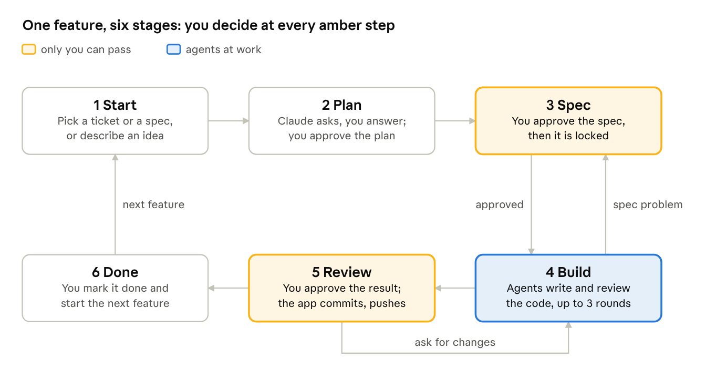
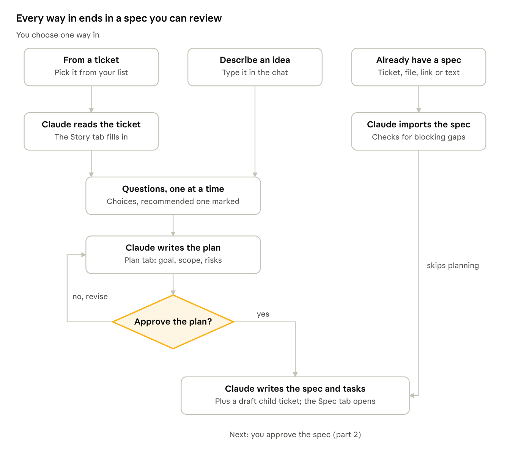
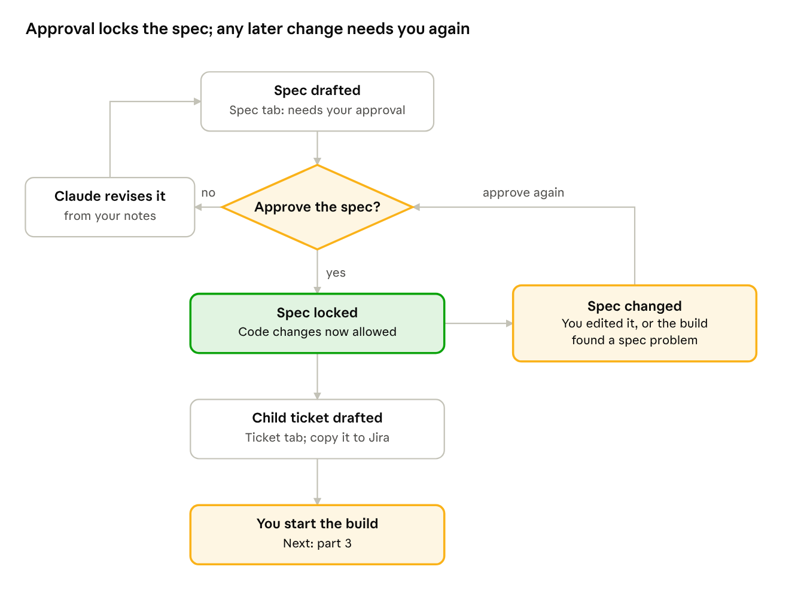
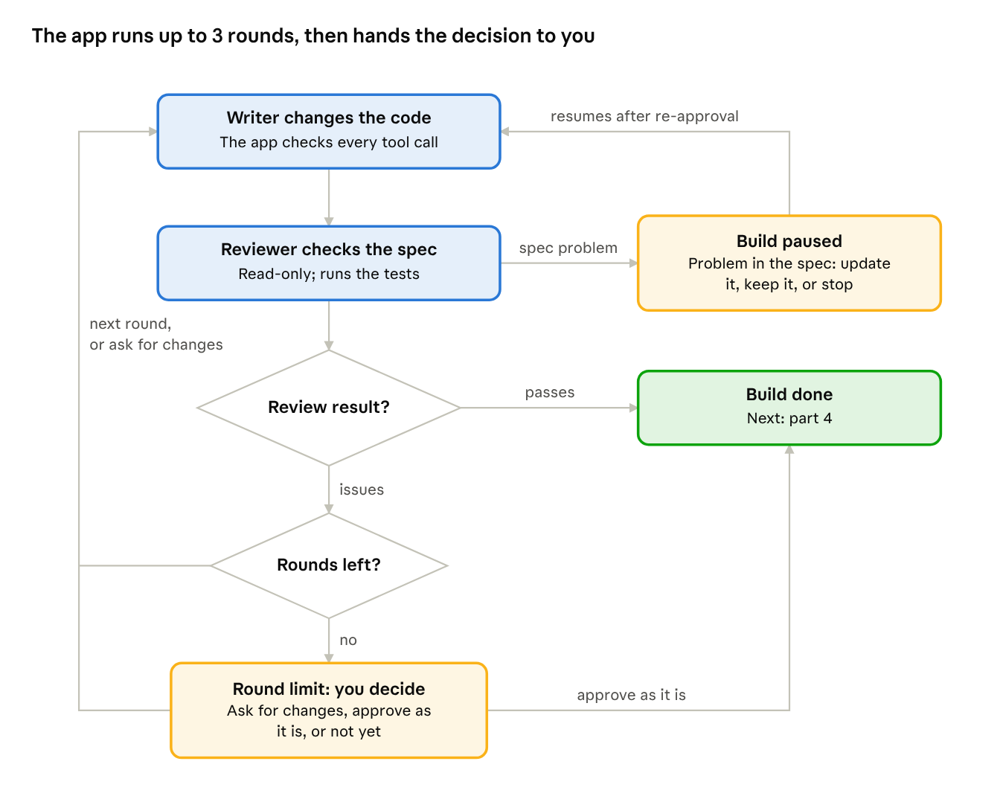
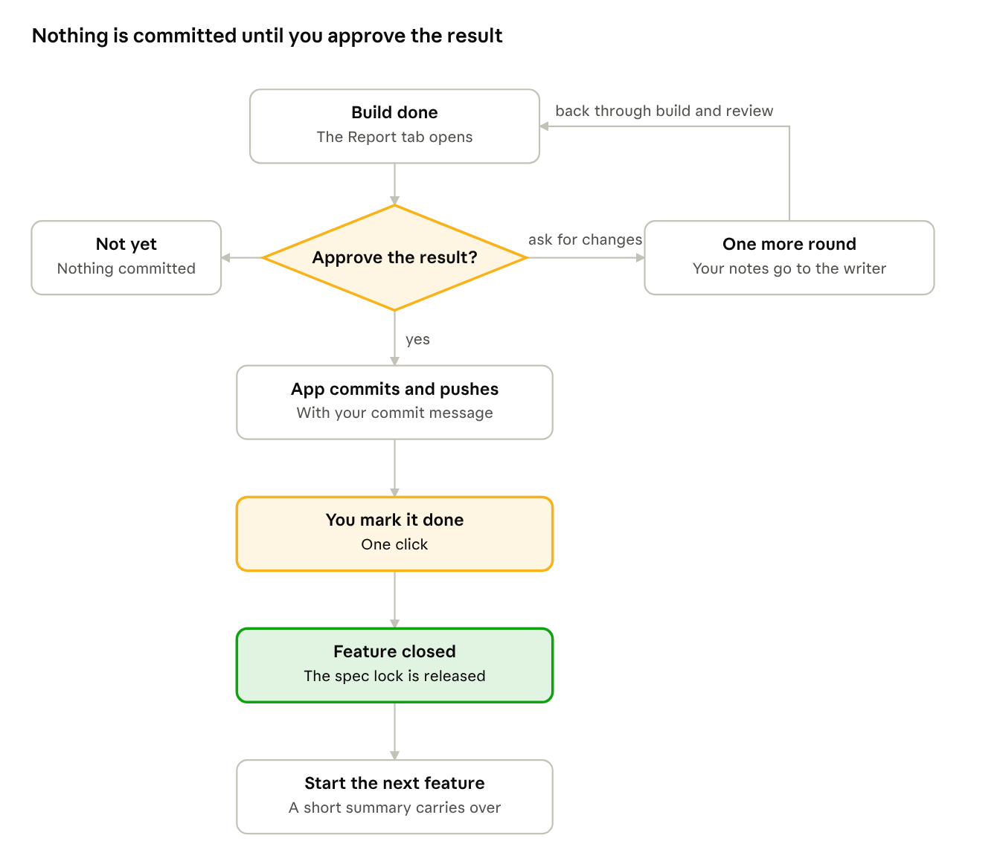

# SDD Harness — Workflow

17 Nov 2026 · Companion to [`PRD.md`](PRD.md) and [`design-notes.md`](design-notes.md)

One feature moves through six stages: Start, Plan, Spec, Build, Review, Done. Amber steps wait on you; the app and its agents do the rest. The first diagram shows the whole loop; the next four zoom into each part.

## The whole workflow at a glance

Read clockwise from Start. The amber stages are the gates only you can pass. A spec problem found during the build sends the work back to the spec, asking for changes after the build sends it back to the agents, and Done leads straight into the next feature.

## 1 · Start and plan

A ticket or an idea goes through questions and a plan you approve; an existing spec skips planning and is only checked for gaps. All three end with the spec, tasks and a draft ticket in the documents pane.

## 2 · Spec approval and the lock

Approving saves the spec's fingerprint (hash) and unlocks code changes. If the spec changes afterwards, by your edit or because the build found a problem in it, the app asks you to approve it again before work continues. In v1 the child ticket stays a draft in the Ticket tab for you to copy into the tracker (PRD D8).

## 3 · Build and review loop

The writer and the reviewer are separate agents with different tools; the app checks every call and logs blocked ones. Issues send the code back for another round until the limit (3 by default), when the app stops and asks you. A problem in the spec itself pauses the build until you decide; the Tasks panel shows which task each step is on.

## 4 · Review the result and ship

The app, never an agent, commits and pushes, and only after you approve. Asking for changes runs one more build and review, counted separately from the round limit; marking it done closes the feature and frees the project for the next one.

## Who can do what

Only you make decisions; the app does the git work; each agent job has a fixed tool set that the app checks on every call.

| Action                          | You                 | App                 | Plans and chats | Writes code         | Reviews code | Reads big files |
| ------------------------------- | ------------------- | ------------------- | --------------- | ------------------- | ------------ | --------------- |
| Pick a source, answer questions | yes                 |                     | asks            |                     |              |                 |
| Read project files              |                     |                     | yes             | yes                 | yes          | yes             |
| Read Jira, docs, web pages      |                     |                     | yes             |                     |              | yes             |
| Write the plan and spec         |                     |                     | until approval  |                     |              |                 |
| Approve plan, spec, result      | yes                 |                     |                 |                     |              |                 |
| Change an approved spec         | yes (Claude drafts) |                     |                 |                     |              |                 |
| Edit source files               |                     |                     |                 | after spec approval |              |                 |
| Run tests and build             |                     |                     |                 | yes                 | tests only   |                 |
| Flag a spec problem             |                     | pauses the build    |                 |                     | yes          |                 |
| Stop after the round limit      |                     | yes                 |                 |                     |              |                 |
| Commit and push                 |                     | after your approval |                 |                     |              |                 |
| Mark as done                    | yes                 |                     |                 |                     |              |                 |

## Reference: stages, states and screens

| Stage         | Internal states                        | Waiting on                                      | Screens (`docs/design/`)                  |
| ------------- | -------------------------------------- | ----------------------------------------------- | ----------------------------------------- |
| Start         | idle                                   | You                                             | `Flow0Empty`                              |
| Plan          | planning, plan-approved                | Claude, then you for each question and the plan | `Flow1Start`, `Main`                      |
| Spec          | spec-drafted, spec-changed             | You                                             | `Main`                                    |
| Build         | spec-approved, implementing, reviewing | You to start, then the agents                   | `Flow3Approved`, `Flow4Building`, `Build` |
| Build, paused | paused                                 | You                                             | `Build2Paused`                            |
| Review        | build-done (or round limit reached)    | You                                             | `Flow5Done`, `Build3Limit`                |
| Done          | closed                                 | Nobody                                          | `Flow6Closed`                             |

The internal states and events come from the sdd plugin's `hooks/machine.ts` (v0.18.0): nodes `idle`, `planning`, `plan-approved`, `spec-drafted`, `spec-approved`, `spec-changed`, `implementing`, `reviewing`, `paused`, `build-done`, `closed` and the side node `data-agent`; events `START`, `APPROVE_PLAN`, `DRAFT_SPEC`, `APPROVE_SPEC`, `EDIT_SPEC`, `START_BUILD`, `IMPLEMENTED`, `REVIEW_ISSUES`, `REVIEW_PASSED`, `SPEC_PROBLEM`, `REVISE`, `REAPPROVE`, `REQUEST_CHANGES`, `CLOSE`, `START_NEXT`, `DATA_START`, `DATA_STOP`, `DATA_STOP_BUILD`. Users only ever see the six stage names.
